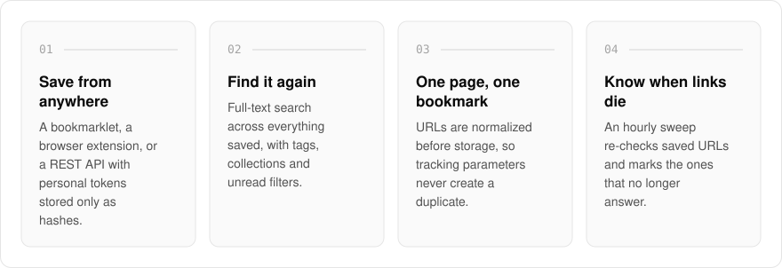
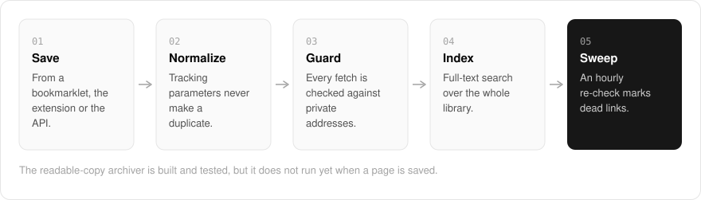

  <picture>
    <source media="(prefers-color-scheme: dark)" srcset=".github/assets/hero-dark.png">
    
  </picture>

<h1 align="center">save.me.at</h1>

<strong>Save the page, not just the link.</strong>

  
  
  
  

  <a href="#features">Features</a> ·
  <a href="#how-it-works">How it works</a> ·
  <a href="#built-with">Built with</a>

A bookmark is only as good as the site it points at, and sites go away. I built save.me.at so a dead link is not a lost page: bookmarks and read-later, designed to keep a readable copy of everything you save. Everything you save gets tags, collections and full-text search, an hourly sweep tells you which links stopped answering, and the whole library exports as readable files whenever you want to leave.

> **Status:** in development. Saving, the library, search and export work today. The archiver that makes the readable copy is written and tested, but it does not run yet when a page is saved.

  <picture>
    <source media="(prefers-color-scheme: dark)" srcset=".github/assets/overview-dark.svg">
    
  </picture>

## Why save.me.at

| The usual bookmark manager | save.me.at |
| --- | --- |
| A flat list of links | A library with tags, collections and full-text search |
| A dead link fails silently | An hourly sweep marks links that stopped answering |
| Tracking parameters make duplicates | URLs are normalized, so one page is one bookmark |
| Hard to get your data out | Everything exports as an archive of readable files |

## Features

- **Save from anywhere**: a bookmarklet, a Manifest V3 browser extension, or a REST API with personal tokens (stored only as hashes).
- **A searchable library**: every bookmark with its tags, read state and a dead-link mark, with full-text search and tag or unread filters.
- **One page, one bookmark**: URLs are normalized before they are stored, so tracking parameters do not create duplicates.
- **Guarded fetching**: every fetch is checked against private network addresses and redirects that try to reach them, tested against a corpus of hostile URLs.
- **Dead-link sweep**: an hourly sweep re-checks saved URLs and marks the ones that no longer answer.
- **Collections**: nested collections, private by default, with optional public sharing of links, titles and descriptions.
- **Import and export**: everything saved comes out as an archive of readable files.
- **Readable copies (in progress)**: extraction, sanitizing and a pooled headless-browser renderer, served from object storage through signed URLs.

## How it works

  <picture>
    <source media="(prefers-color-scheme: dark)" srcset=".github/assets/flow-dark.svg">
    
  </picture>

A save arrives from the bookmarklet, the extension or the API, and its URL is normalized so the same page never becomes two bookmarks. The page's details are fetched through a guard that refuses private network addresses, then the bookmark joins the full-text index. Every hour a sweep re-checks saved URLs and marks the dead ones.

## Built with

  
  
  
  
  
  

- Next.js 16 (App Router) and React 19
- TypeScript
- Tailwind CSS 4
- Drizzle ORM and Postgres full-text search
- S3-compatible object storage for archived copies
- A shared headless-browser render pool
- Better Auth (shared me.at account)

## Part of the me.at family

save.me.at is one of my [`*.me.at`](https://me.at) apps. They share one design system, account, and app shell. Development happens in a private monorepo; this repository is the project's public-facing home.

## License

Source-available. See [LICENSE](LICENSE).
