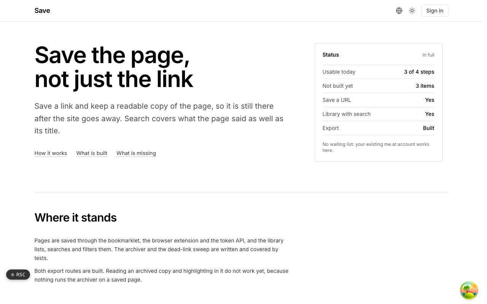

  <picture>
    <source media="(prefers-color-scheme: dark)" srcset=".github/assets/hero-dark.png">
    
  </picture>

# save.me.at

Save the page, not just the link.

Save is bookmarks and read-later that keep a readable copy of the page, so it is still there after the site goes away. Saved pages get tags, collections and full-text search, so a dead link is not a lost page. Saving, the library, search and export work today; the archiver that makes the readable copy is written and tested but is not yet run when a page is saved.

## Features

- **Save from anywhere**: a bookmarklet, a Manifest V3 browser extension, or a REST API with personal tokens (stored only as hashes).
- **A searchable library**: every bookmark with its tags, read state and a dead-link mark, with full-text search and tag or unread filters.
- **One page, one bookmark**: URLs are normalized before they are stored, so tracking parameters do not create duplicates.
- **Guarded fetching**: every fetch is checked against private network addresses and redirects that try to reach them, tested against a corpus of hostile URLs.
- **Dead-link sweep**: an hourly sweep re-checks saved URLs and marks the ones that no longer answer.
- **Collections**: nested collections, private by default, with optional public sharing of links, titles and descriptions.
- **Import and export**: everything saved comes out as an archive of readable files.
- **Readable copies (in progress)**: extraction, sanitizing and a pooled headless-browser renderer, served from object storage through signed URLs.

## Built with

- Next.js 16 (App Router) and React 19
- TypeScript
- Tailwind CSS 4
- Drizzle ORM and Postgres full-text search
- S3-compatible object storage for archived copies
- A shared headless-browser render pool
- Better Auth (shared me.at account)

## Part of the me.at family

save.me.at is one of my [`*.me.at`](https://me.at) apps. They share one design system, account, and app shell. Development happens in a private monorepo; this repository is the project's public-facing home.

## License

See [LICENSE](LICENSE).
